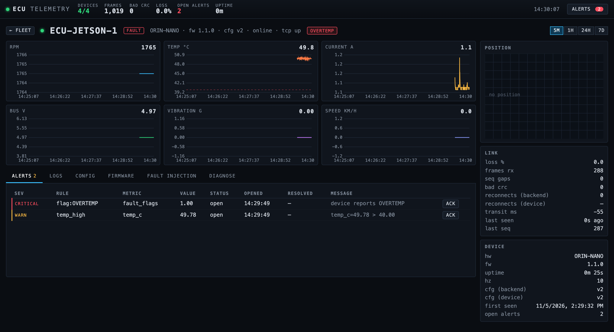

# Real hardware target: Jetson Orin Nano Super

First real device for the stack (2026-10-27). The backend stays on the Mac; the board runs the agent and reaches the Mac over Tailscale (ingest UDP :8781, TCP :8782 at the Mac's tailnet address, bound `0.0.0.0` by `ECU_BIND`'s default).

## Build on the board

Ubuntu 24.04 arm64, gcc 13.3, cmake 3.28. Native build takes ~5 s, CTest 15/15 in ~1 s. No code changes were needed for aarch64.

```
make jetson-deploy      # rsync firmware/ docs/ deploy/ → build → ctest → restart service
make jetson-logs        # journalctl -f for the agent
```

`JETSON=<ssh alias>` overrides the host (default `jetson`, see the `jetson` repo for the aliases).

## Run at boot

`deploy/jetson/install.sh` (run once on the board) installs `deploy/jetson/ecu-agent.service` as a **user** service enabled for `default.target`; settings live in `~/ecu-telemetry/agent.env` (device id, backend address, hw/fw strings, profile). `Restart=always` so a crash or a backend outage just reconnects (the agent already backs off on its own).

Device ids are at most 12 characters: `ECU-JETSON-1`.

## First result

`ECU-JETSON-1` online in the dashboard at 10 Hz, `loss_pct` 0.0 over Wi-Fi + Tailscale (direct path, no relay), TCP control channel connected on the first try.

## Real signals: `--source jetson`

`firmware/src/sensors.cpp` discovers the board's sensors under sysfs and the agent overwrites the plant model's motor fields with them each tick (`Agent::readSensors`). Remote fault injection and the comm-degraded bit still come from the plant; the threshold checks (`temp_limit_c`, `current_limit_a`, `rpm_limit`, plus `--undervoltage`, 4.5 V by default on the Jetson) run on the measured values, so device-side alerts, `fault_flags` and `state` are real.

| Telemetry field | Source on the Jetson | Note |
|---|---|---|
| `temp_c` | `/sys/class/thermal/*/temp`, zone `tj-thermal` (hottest readable zone otherwise) | millidegrees → °C |
| `voltage_v`, `current_a` | INA3221 channel labelled `VDD_IN` (`/sys/bus/i2c/drivers/ina3221/*/hwmon/*`) | the board's input rail; mV/mA → V/A |
| `rpm` | `/sys/devices/platform/pwm-fan/hwmon/*/pwm1` | duty/255 × 6000: the fan is the board's one motor; an estimate, the fan has no tach |
| `vibration_g`, `speed_kph`, `lat`, `lon` | none | reported as 0 |

`--source sysfs:ROOT` reads the same paths under `ROOT`; `tests/fixtures/jetson-sysfs/` is a copy of the board's tree and drives the `sysfs_sensors` unit test and the `agent_runs_sysfs` CTest. `--source jetson` exits 2 on a machine without the tree.

The service passes `$ECU_EXTRA` from `agent.env` (`--source jetson`). First live run 2026-10-28: 48.4 °C, 4.98 V, 1.11 A, 1600 rpm at idle.

Device-side thresholds have hysteresis (1 °C, 5 % of the current limit, 0.1 V, 2 % of the rpm limit): without it the board hovering at exactly the limit produced 13 OVERTEMP set/clear pairs in a minute.

### A real thermal event (2026-10-28)

Config v2 pushed from the backend (`temp_limit_c` 52, applied over the control channel), then all six cores (`yes` ×6) and the GPU (`trtexec` ResNet-50) loaded for 75 s:

- junction temperature 48.5 → 54.8 °C, fan 1600 → 2188 rpm, input current 1.11 → 1.22 A
- device: `ALERT OVERTEMP: temp 52.1C > limit 52.0C`, `fault_flags` 0x01, `state` FAULT for 400 samples
- backend: `temp_high` (warn) and `flag:OVERTEMP` (critical) opened 03:37:42, auto-resolved 03:40:36 once the board had cooled; the EWMA anomaly rule also flagged the current step when the load started

The backend's fixed 80 V `voltage_low` rule would have been permanently true for a 5 V board, so threshold rules now take per-device `overrides` matched by `device_id` or `hw_model`; the default rules carry `{"hw_model": "ORIN-NANO", "value": 4.5}`.

## In the demo fleet (2026-11-05)

`make demo-jetson` runs `sim/scenarios/jetson.yml`: three simulated ECUs started locally and this board's agent started over ssh with `--source jetson`, all against one fresh backend. No service has to be installed for it; the agent lives as long as the run does.



What the scenario does to the board, and asserts (11 checks, 11/11 on three consecutive runs):

- it comes online with telemetry at firmware 1.1.0
- a config push sets `temp_limit_c` to 40, the board acks version 2, and its own protection raises `OVERTEMP` on the temperature it is measuring (49.7 °C); the backend opens `flag:OVERTEMP` and `temp_high`
- the limit goes back to 90 and both alerts resolve
- firmware 1.2.0 is deployed: the agent acks, drops its connection, comes back and says HELLO as 1.2.0
- loss over Tailscale stays at 0.0 %

The OTA here restarts the agent in-process and the version is whatever `--fw` says at the next start; nothing is written to the board. CTest on the board is 19/19, including the golden frames.

`transit_ms` for this device reads about -55 ms. It is receive time on the Mac minus the timestamp the board put in the frame, so it carries the difference between the two clocks: the board's is ahead by more than the network takes. One-way latency cannot be read off two unsynchronised clocks; the number is only meaningful for devices on the backend's own clock.

## Next on this board

See `GOALS.md` → "Jetson week": real sensors (`/sys/class/thermal`, INA3221), SocketCAN source, OTA to the real service, SIL with a mixed fleet, arm64 container image.
